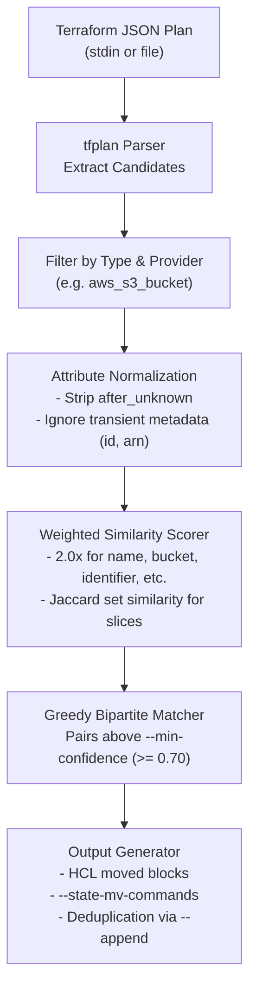

# tf-move-gen

[](https://github.com/smford/tf-move-gen)
[](LICENSE)

**Automated Refactoring Generator for Terraform & OpenTofu `moved` Blocks**

`tf-move-gen` is a zero-dependency, single-binary CLI utility that inspects Terraform/OpenTofu JSON execution plans, isolates planned `destroy` and `create` resource changes, matches pairs using weighted attribute similarity, and automatically generates valid HCL `moved` blocks.

Refactor your infrastructure with complete confidence—never suffer accidental resource deletion when renaming resources, converting `count` to `for_each`, or extracting resources into child modules.

---

## The Problem

When you refactor Terraform code—e.g., extracting an `aws_s3_bucket` into a module, renaming a resource, or converting subnets from `count` to `for_each`—Terraform plans to **destroy** existing infrastructure and **recreate** it at the new address.

Writing dozens of `moved { from = ... to = ... }` blocks by hand is tedious, slow, and error-prone. `tf-move-gen` eliminates this risk by pairing deleted resources with their newly created counterparts based on deep configuration similarity.

```hcl
# Generated by tf-move-gen
# Confidence: 100.0% (matched on: acl, bucket, force_destroy, tags)
moved {
  from = aws_s3_bucket.media
  to   = module.storage.aws_s3_bucket.media
}
```

---

## Features

- **Weighted Structural Similarity:** High-signal identifying attributes (`name`, `bucket`, `identifier`, `cidr_block`, `function_name`, `role`, `tags.Name`) receive 2.0x weight over generic defaults.
- **Computed Field Stripping:** Intelligently ignores transient provider metadata (`id`, `arn`, `etag`, `unique_id`, `create_date`) and attributes marked in `after_unknown`.
- **Deterministic Bipartite Matching:** Optimal greedy matching guarantees resources (e.g. subnets with specific CIDR blocks) pair with their exact match rather than pairing arbitrarily.
- **Address Normalization:** Formats module paths, `count` numeric indices (`aws_subnet.public[0]`), and string `for_each` keys (`aws_subnet.public["10.0.1.0/24"]`) correctly for HCL.
- **Confidence Reports (`--explain`):** Annotates each `moved` block with its similarity score and matched attributes, reporting unmatched deletions as warnings.
- **Legacy Shell Output (`--state-mv-commands`):** Outputs shell-safe `terraform state mv '<from>' '<to>'` commands for cross-state operations or older Terraform versions.
- **CI Safety Gate (`--fail-on-unmatched-delete`):** Returns exit code `2` if any destructive deletion cannot be matched, safeguarding CI/CD pipelines.
- **Deduplication (`--append`):** Merges new moves into an existing `moves.tf` without producing duplicate blocks.
- **Zero-CGO & Offline:** Compiles to a static binary with no external runtime dependencies; processes JSON offline without provider API calls. Compatible with both **Terraform** and **OpenTofu**.

---

## Installation

### From Source (Go 1.23+)

```bash
go install github.com/smford/tf-move-gen/cmd/tf-move-gen@latest
```

### Build Locally

```bash
git clone https://github.com/smford/tf-move-gen.git
cd tf-move-gen
make build
# Binary is built at bin/tf-move-gen
```

---

## Usage & Workflow

### 1. Standard Refactoring Workflow

Run your plan, pipe the JSON output directly to `tf-move-gen`, and verify:

```bash
# Generate the execution plan
terraform plan -out=tfplan

# Analyze plan and generate moves.tf
terraform show -json tfplan | tf-move-gen --explain --out=moves.tf

# Re-run plan to verify clean state: 0 to add, 0 to change, 0 to destroy!
terraform plan
```

### 2. Working with OpenTofu

`tf-move-gen` is 100% compatible with OpenTofu:

```bash
tofu plan -out=tfplan
tofu show -json tfplan | tf-move-gen --explain --out=moves.tf
tofu plan
```

### 3. Generate Legacy State Move Commands

For surgical cross-state operations or Terraform < 1.1:

```bash
terraform show -json tfplan | tf-move-gen --state-mv-commands
```

Output:
```bash
terraform state mv 'aws_subnet.public[0]' 'aws_subnet.public["10.0.1.0/24"]'
terraform state mv 'aws_subnet.public[1]' 'aws_subnet.public["10.0.2.0/24"]'
terraform state mv 'aws_subnet.public[2]' 'aws_subnet.public["10.0.3.0/24"]'
```

### 4. CI Safety Gate

Prevent accidental resource destruction in CI pull request checks:

```bash
terraform show -json tfplan | tf-move-gen --fail-on-unmatched-delete --explain --out=moves.tf
```

If unexpected resources are slated for destruction without a matching replacement, `tf-move-gen` exits with code `2`.

---

## CLI Reference

```
Usage: tf-move-gen [flags] [plan.json]

Flags:
  --min-confidence float
        Minimum similarity threshold between 0.0 and 1.0 (default 0.70)
  --out string
        Write generated HCL blocks directly to a file (e.g. moves.tf)
  --append
        Append to --out file if it already exists, deduplicating existing moved blocks
  --explain
        Include comments above each moved block showing confidence score and warn on unmatched deletes
  --state-mv-commands
        Output legacy terraform state mv shell commands instead of HCL moved blocks
  --fail-on-unmatched-delete
        Exit with code 2 if any destructive resource deletion remains unmatched
```

### Exit Codes

| Code | Meaning |
|------|---------|
| `0`  | Success (moves generated or no candidates to match) |
| `1`  | Error (invalid CLI flags, malformed JSON, I/O failure) |
| `2`  | Unmatched deletion remaining when `--fail-on-unmatched-delete` is specified |

---

## How It Works



1. **Candidate Extraction:** Scans `resource_changes` for `delete` and `create` actions of `managed` resources.
2. **Provider & Type Partitioning:** Only matches resources of the same `type` and `provider_name` (e.g., `aws_db_instance` to `aws_db_instance`).
3. **Computed Field Stripping:** Suppresses fields listed in `after_unknown` or recognized as transient infrastructure metadata (`id`, `arn`, `etag`, `unique_id`, etc.).
4. **Weighted Similarity Scoring:** Calculates an attribute match score between 0.0 and 1.0, applying a 2.0x multiplier to high-signal identifiers and evaluating collection attributes using structural Jaccard similarity.
5. **Greedy Bipartite Matching:** Matches pairs from highest confidence to lowest confidence above `--min-confidence`.
6. **Code Generation:** Outputs cleanly formatted HCL `moved` blocks or shell-escaped `terraform state mv` commands.

---

## Contributing & Development

```bash
# Run tests with race detection
make test

# Run linter / static analysis
make vet

# Build binary
make build
```

## License

MIT License. See [LICENSE](LICENSE) for details.