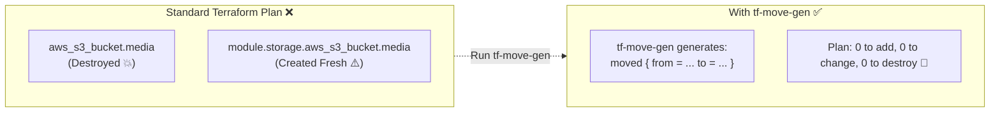

# tf-move-gen

[](https://github.com/smford/tf-move-gen/actions/workflows/ci.yml)
[](https://smford.github.io/tf-move-gen/)
[](https://golang.org)
[](https://github.com/smford/tf-move-gen/releases)
[](https://securityscorecards.dev/viewer/?uri=github.com/smford/tf-move-gen)
[](LICENSE)

**Automated Refactoring Generator for Terraform & OpenTofu `moved` Blocks**

`tf-move-gen` is an automated infrastructure refactoring utility. It inspects your planned Terraform or OpenTofu changes, detects when resources are being renamed or extracted into modules, and automatically generates valid HCL `moved { from = ... to = ... }` blocks so your existing cloud infrastructure is never destroyed by accident.

📖 **[Explore the Interactive Documentation Portal](https://smford.github.io/tf-move-gen/)** — Built with [`md-web-renderer`](https://github.com/smford/md-web-renderer) for zero-build search, graphical topology maps, and interactive diagrams.

---

## What Is tf-move-gen?

When you refactor code in Terraform—such as moving an S3 bucket into a module or converting subnets to `for_each`—Terraform sees the old resource address disappear and a new one appear.

By default, Terraform will plan to **delete** your existing live infrastructure and **re-create** it from scratch at the new address.

`tf-move-gen` fixes this by analyzing your execution plan JSON (`terraform show -json tfplan`). It compares deleted resources against created resources using weighted attribute similarity and automatically writes HCL `moved` blocks. When Terraform sees these blocks, it updates state in place with **zero downtime and zero resource destruction**.



---

## Problems tf-move-gen Solves

Refactoring Infrastructure-as-Code is one of the highest-risk activities in DevOps and Cloud Engineering. Here are the core challenges `tf-move-gen` eliminates:

### 1. Accidental Cloud Resource Destruction
In Terraform, an object's identity is strictly bound to its code address. Renaming `aws_db_instance.db` to `aws_db_instance.primary` causes Terraform to schedule a destroy-and-recreate cycle. For stateful infrastructure (databases, storage buckets, VPC subnets, Elastic IPs), recreation means **data loss, IP reassignment, and service downtime**.

### 2. The Exhaustion of Writing `moved` Blocks by Hand
Terraform 1.1 introduced `moved` blocks, but in realistic migrations:
- A single architecture cleanup can move **50+ resources**.
- Writing each block manually is repetitive, tedious, and highly error-prone.
- A single typo in an address expression will fail your plan or leave resources slated for deletion.

### 3. Mis-Mapped Multi-Resource Conversions
Converting resources from numeric `count` (`[0]`, `[1]`, `[2]`) to `for_each` (e.g. `["10.0.1.0/24"]`) frequently results in human errors. If you manually match the wrong index to the wrong CIDR block or subnet ID, subnets get swapped and routing tables break.

`tf-move-gen` uses **bipartite matching** and deep attribute analysis (`cidr_block`, `availability_zone`, `vpc_id`) to mathematically guarantee each resource is matched with its exact configuration counterpart.

### 4. Blind PR Reviews & Destructive Diff Fatigue
Reviewers cannot easily spot a single destructive deletion buried inside a massive pull request plan containing dozens of changes.

`tf-move-gen` provides confidence scores with `--explain` and serves as an automated PR gate with `--fail-on-unmatched-delete`. If any resource deletion lacks an intentional, matching target, CI immediately halts the build.

---

## Quick Start

### 1. Run Your Refactor

Extract or rename your resources in your Terraform files as usual.

### 2. Generate Plan JSON & Run tf-move-gen

```bash
# Generate the execution plan
terraform plan -out=tfplan

# Analyze plan and auto-generate moves.tf
terraform show -json tfplan | tf-move-gen --explain --out=moves.tf
```

`moves.tf` is instantly generated:

```hcl
# Confidence: 100.0% (matched on: acl, bucket, force_destroy, tags)
moved {
  from = aws_s3_bucket.media
  to   = module.storage.aws_s3_bucket.media
}

# Confidence: 100.0% (matched on: assume_role_policy, description, name)
moved {
  from = aws_iam_role.worker
  to   = module.compute.aws_iam_role.worker
}
```

### 3. Verify Clean Plan

Re-run `terraform plan`:

```text
module.storage.aws_s3_bucket.media has moved to aws_s3_bucket.media
module.compute.aws_iam_role.worker has moved to aws_iam_role.worker

No changes. Your infrastructure matches the configuration.
```

---

## Installation

`tf-move-gen` is compiled as a standalone static binary with zero runtime dependencies. Choose your preferred installation method:

### 1. Homebrew (macOS & Linux) — Recommended

```bash
brew install smford/tap/tf-move-gen
```

Or add the tap manually:

```bash
brew tap smford/homebrew-tap
brew install tf-move-gen
```

### 2. Shell Installer Script (macOS & Linux)

Install the latest release directly to `/usr/local/bin` (or `~/.local/bin`):

```bash
curl -fsSL https://raw.githubusercontent.com/smford/tf-move-gen/main/scripts/install.sh | bash
```

### 3. Go Install (Go 1.23+)

```bash
go install github.com/smford/tf-move-gen/cmd/tf-move-gen@latest
```

Ensure `$GOPATH/bin` (or `$HOME/go/bin`) is included in your `$PATH`.

### 4. Docker Container

Run directly without installing anything on your host machine:

```bash
docker pull ghcr.io/smford/tf-move-gen:latest

# Pipe plan directly into Docker
terraform show -json tfplan | docker run --rm -i ghcr.io/smford/tf-move-gen:latest --explain
```

### 5. Download Precompiled Binaries

Download precompiled static archives from the [Latest GitHub Release](https://github.com/smford/tf-move-gen/releases/latest):

| Operating System | Architecture | Download Link |
| :--- | :--- | :--- |
| **macOS** | Apple Silicon (M1/M2/M3/M4) | [`tf-move-gen_0.1.0_darwin_arm64.tar.gz`](https://github.com/smford/tf-move-gen/releases/latest/download/tf-move-gen_0.1.0_darwin_arm64.tar.gz) |
| **macOS** | Intel (x86_64) | [`tf-move-gen_0.1.0_darwin_amd64.tar.gz`](https://github.com/smford/tf-move-gen/releases/latest/download/tf-move-gen_0.1.0_darwin_amd64.tar.gz) |
| **Linux** | ARM64 (aarch64) | [`tf-move-gen_0.1.0_linux_arm64.tar.gz`](https://github.com/smford/tf-move-gen/releases/latest/download/tf-move-gen_0.1.0_linux_arm64.tar.gz) |
| **Linux** | x86_64 (amd64) | [`tf-move-gen_0.1.0_linux_amd64.tar.gz`](https://github.com/smford/tf-move-gen/releases/latest/download/tf-move-gen_0.1.0_linux_amd64.tar.gz) |
| **Windows** | x86_64 (amd64) | [`tf-move-gen_0.1.0_windows_amd64.zip`](https://github.com/smford/tf-move-gen/releases/latest/download/tf-move-gen_0.1.0_windows_amd64.zip) |

### 6. Build from Source

```bash
git clone https://github.com/smford/tf-move-gen.git
cd tf-move-gen
make build
# Binary is located at bin/tf-move-gen
./bin/tf-move-gen --version
```

See the [Interactive Installation Guide](https://smford.github.io/tf-move-gen/#installation.md) for complete details.

---

## Key Features

- **Weighted Bipartite Matching:** Identifying attributes (`name`, `bucket`, `identifier`, `cidr_block`, `function_name`, `role`, `tags.Name`) receive 2.0x weight over generic flags.
- **Computed Field Stripping:** Strips out `after_unknown` values and transient metadata (`id`, `arn`, `etag`, `unique_id`, `create_date`) so newly planned resources match existing ones at >95% confidence.
- **Set & List Jaccard Index:** Evaluates list and set attributes (security group rules, CIDR blocks, tags) using set intersection metrics.
- **Legacy Shell Output:** Generates `terraform state mv '<from>' '<to>'` commands via `--state-mv-commands` for older Terraform versions or cross-state surgery.
- **CI Safety Gate:** Halts pull requests with exit code `2` via `--fail-on-unmatched-delete` whenever an unmatched deletion is discovered.
- **Deduplication:** Appends to existing `moves.tf` files without duplicating blocks via `--append`.
- **Zero-CGO & 100% Offline:** Single static binary with zero runtime dependencies. Operates entirely offline without making cloud API calls.
- **OpenTofu Compatible:** Works identically with `tofu show -json tfplan`.

---

## CLI Reference

```text
Usage: tf-move-gen [flags] [plan.json]

Flags:
  --min-confidence float
        Minimum similarity threshold between 0.0 and 1.0 (default 0.70)
  --out string
        Write generated HCL blocks directly to a file (e.g. moves.tf)
  --append
        Append to --out file if it already exists, deduplicating existing moved blocks
  --explain
        Include comments above each moved block showing confidence score and warn on unmatched deletes
  --state-mv-commands
        Output legacy terraform state mv shell commands instead of HCL moved blocks
  --fail-on-unmatched-delete
        Exit with code 2 if any destructive resource deletion remains unmatched
  --serve-healthz string
        Start an HTTP health check daemon (e.g. :8080) for container DAST testing
```

---

## Documentation Site

The full documentation is available as an interactive portal:

- **[Getting Started Guide](https://smford.github.io/tf-move-gen/#getting-started.md)**: Full walkthrough with example code.
- **[System Architecture](https://smford.github.io/tf-move-gen/#architecture.md)**: Parser, matcher, and generator pipelines.
- **[Matching Algorithm & Heuristics](https://smford.github.io/tf-move-gen/#matching-algorithm.md)**: Deep dive into the scoring formula and bipartite pairing.
- **[CLI Reference](https://smford.github.io/tf-move-gen/#cli-reference.md)**: Complete flags and exit code guide.
- **[CI/CD Integration](https://smford.github.io/tf-move-gen/#ci-cd-integration.md)**: Automated PR safety gate workflows.

To serve documentation locally:

```bash
make docs-serve
# Browse at http://localhost:8000
```

---

## Development

```bash
# Run tests with race detection and coverage
make test

# Run linter
make lint

# Compile static binary
make build

# Clean artifacts
make clean
```

---

## License

MIT License. See [LICENSE](LICENSE) for details.
