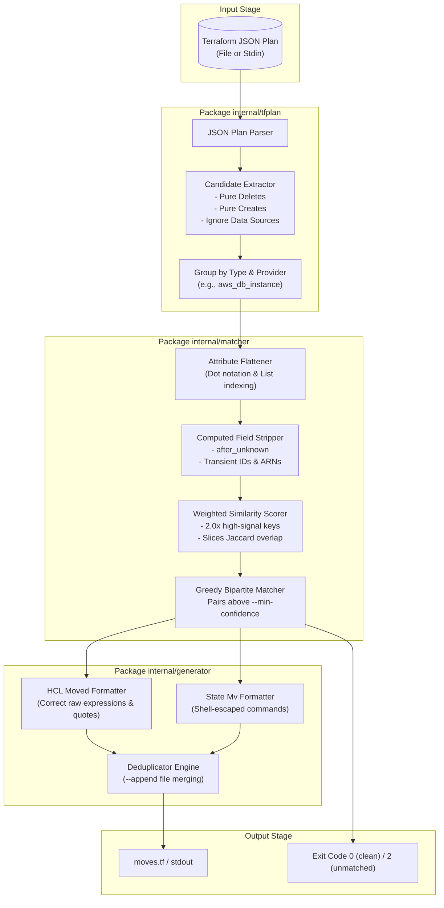
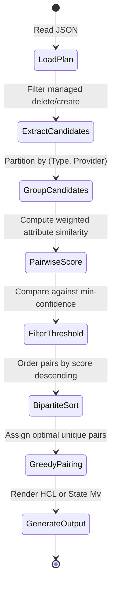

# System Architecture

`tf-move-gen` is engineered as a zero-CGO, single-binary Go utility that operates as a pure data-transformation pipeline on Terraform and OpenTofu execution plan JSON.

---

## High-Level Pipeline

---

## Package Breakdown

### 1. `internal/tfplan` — Plan Parser & Candidate Extractor

The `tfplan` package deserializes the output of `terraform show -json` or `tofu show -json`.

- **Candidate Isolation:** Inspects each entry in `resource_changes`. A resource change is considered a candidate source if its mode is `managed` and its actions are `["delete"]` (or a replacement where addresses differ). A resource is considered a candidate target if its actions are `["create"]`.
- **Mode Filtering:** Data sources (`mode == "data"`) and unchanged resources (`["no-op"]` or `["read"]`) are excluded from matching.
- **Provider Normalization:** Providers like `registry.terraform.io/hashicorp/aws` and `aws` are normalized to their base names to ensure compatibility across modules and registry prefixes.

### 2. `internal/matcher` — Similarity Engine & Bipartite Matcher

The `matcher` package pairs candidate deletions with candidate creations.

- **Group Partitioning:** Candidates are strictly grouped by `(ResourceType, Provider)`. Resources of differing types (e.g., `aws_s3_bucket` and `aws_iam_role`) are never compared.
- **Flattening:** Nested maps and block slices are recursively flattened into dot-separated paths (e.g., `tags.Environment`, `versioning[0].enabled`).
- **Computed Field Stripping:** Suppresses attributes present in `after_unknown` and known transient provider attributes (`id`, `arn`, `etag`, `unique_id`, `create_date`).
- **Weighted Jaccard Scoring:** Evaluates configuration equality with 2.0x weight for identifying attributes (`name`, `bucket`, `identifier`, `cidr_block`, `tags.Name`).
- **Greedy Bipartite Matching:** Computes all pairwise scores in each group, sorts candidates descending by score, and greedily selects the best non-overlapping matches above `--min-confidence`.

### 3. `internal/generator` — Code Generation & Deduplication

The `generator` package turns matched pairs into actionable code:

- **HCL Formatting:** Generates clean HCL `moved` blocks. Terraform requires `from` and `to` to be unquoted raw expressions, while preserving internal string keys (e.g. `aws_subnet.public["10.0.1.0/24"]`).
- **State MV Commands:** When `--state-mv-commands` is requested, formats shell-escaped `terraform state mv '<from>' '<to>'` commands.
- **Deduplication:** When `--append` is specified, the generator parses existing moved blocks in the target file and ensures duplicate moves are never inserted.

---

## State Diagram: Matching Lifecycle

---

## Design Principles

1. **Zero External Dependencies at Runtime:** Standard Go libraries only. Compiles with `CGO_ENABLED=0` to a static binary.
2. **100% Offline Execution:** Never dials AWS, Azure, GCP, or HashiCorp APIs. All logic is derived from the plan JSON.
3. **Safety First:** If a resource deletion cannot be matched with confidence, it is surfaced as a warning. In CI, `--fail-on-unmatched-delete` halts the pipeline with exit code 2.
