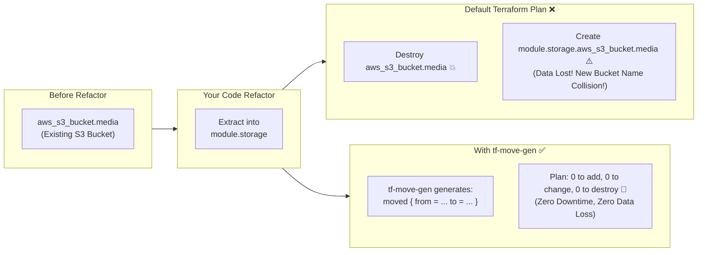
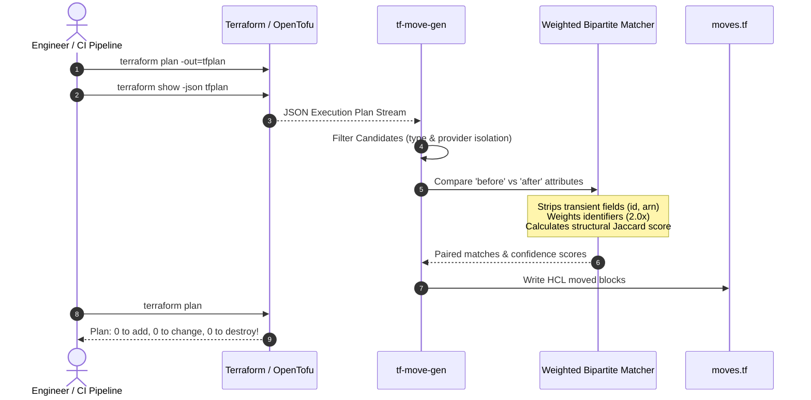

# tf-move-gen

> **Automated Refactoring Generator for Terraform & OpenTofu `moved` Blocks**

[](https://golang.org)
[](https://opensource.org/licenses/MIT)
[](https://github.com/smford/tf-move-gen/releases)

---

## What Is tf-move-gen?

`tf-move-gen` is an automated infrastructure refactoring tool for **Terraform** and **OpenTofu**.

It reads your planned infrastructure changes, automatically detects when you are renaming resources or moving them into modules, and generates the exact HCL `moved { from = ... to = ... }` blocks needed to keep your existing infrastructure intact.

Instead of Terraform destroying your real-world resources and creating brand new ones from scratch, `tf-move-gen` instructs Terraform that the resources simply moved to a new address.



---

## The Problems tf-move-gen Solves

Refactoring Infrastructure-as-Code is notoriously stressful. Even minor code hygiene improvements can trigger accidental outages. Here are the core problems `tf-move-gen` solves:

### 1. The Destructive Refactoring Trap
In Terraform, a resource's identity in state is tied directly to its code address (e.g., `aws_security_group.web`). If you rename that resource to `aws_security_group.ingress_web`, or move it into `module.networking.aws_security_group.web`, Terraform cannot intuitively know it is the same piece of infrastructure. By default, Terraform schedules a **destroy** of the old resource and a **create** of the new one.

### 2. Catastrophic Data Loss & Downtime
For stateless resources, recreation might cause minutes of downtime. For stateful resources—such as **RDS databases, S3 buckets, DynamoDB tables, Elastic IPs, or VPC subnets**—a recreation causes permanent data loss, loss of static IPs, or failed deployments because names or CIDR blocks collide with what already exists in the cloud.

### 3. The Tedium and Error of Manual `moved` Blocks
Terraform 1.1 introduced HCL `moved` blocks so engineers can declare address changes in code. However:
- In realistic module extractions, you may need to move **30 to 100+ resources**.
- Writing each `moved { from = ... to = ... }` block by hand is agonizingly slow.
- Mistyping module prefixes, resource names, or `count` vs `for_each` keys leads to cryptic plan errors.

### 4. Ambiguous Multi-Resource Conversions (e.g., `count` to `for_each`)
Converting multiple resources from numeric `count` (e.g., `aws_subnet.public[0]`, `[1]`, `[2]`) to key-based `for_each` (e.g., `aws_subnet.public["10.0.1.0/24"]`) is notoriously error-prone. If you guess which index maps to which CIDR block, you risk crossing network subnets or re-associating routing tables to the wrong zones.

`tf-move-gen` inspects the underlying attributes (like `cidr_block`, `availability_zone`, `vpc_id`) to mathematically guarantee each resource is paired with its exact match.

### 5. Review Fatigue & PR Uncertainty
When a pull request contains 40 deletions and 40 creations, pull request reviewers are forced to manually cross-reference attributes between before-and-after states to ensure nothing will be accidentally deleted.

`tf-move-gen` automates this verification. With `--explain`, every move is accompanied by a confidence percentage and a list of matched attributes. With `--fail-on-unmatched-delete`, CI automatically halts PRs if any destructive deletion lacks a safe matching target.

---

## How It Works

`tf-move-gen` executes an offline analysis pipeline on your Terraform JSON plan:



1. **Extracts Candidates:** Scans the plan's `resource_changes` for `managed` resources undergoing `delete` and `create` actions.
2. **Partitions by Type & Provider:** Only compares resources of identical types and providers (e.g., `aws_s3_bucket` only matches `aws_s3_bucket`).
3. **Strips Computed Noise:** Ignores fields that are newly computed (`after_unknown`) or transient system metadata (`id`, `arn`, `etag`, `create_date`).
4. **Calculates Weighted Similarity:** Weights high-signal attributes (like `name`, `bucket`, `identifier`, `cidr_block`, `tags.Name`) at 2.0x, and uses Jaccard set similarity for collections.
5. **Greedy Bipartite Matching:** Optimal pairing pairs highest-similarity resources first above the `--min-confidence` threshold (default 70%).
6. **Produces Clean HCL:** Generates syntactically correct `moved` blocks formatted with unquoted addresses, numeric indices, and quoted map keys.

---

## Quick Example

Suppose you extracted an S3 bucket and an IAM role into a `storage` module:

```bash
# 1. Generate your plan as JSON
terraform plan -out=tfplan
terraform show -json tfplan | tf-move-gen --explain --out=moves.tf
```

`moves.tf` is immediately generated:

```hcl
# Confidence: 100.0% (matched on: acl, bucket, force_destroy, tags)
moved {
  from = aws_s3_bucket.media
  to   = module.storage.aws_s3_bucket.media
}

# Confidence: 100.0% (matched on: assume_role_policy, description, name)
moved {
  from = aws_iam_role.worker
  to   = module.compute.aws_iam_role.worker
}
```

Now re-run `terraform plan`:

```text
No changes. Your infrastructure matches the configuration.
```

Zero downtime. Zero manual typing.

---

## Documentation Index

Explore the complete guides:

- [Getting Started Guide](getting-started.md) — Hands-on step-by-step refactoring tutorial.
- [System Architecture](architecture.md) — Internals of the parser, matcher, and generator pipelines.
- [Matching Algorithm & Heuristics](matching-algorithm.md) — Deep dive into the weighted similarity score and bipartite assignment.
- [CLI Reference](cli-reference.md) — Detailed guide to all flags, options, exit codes, and environment variables.
- [CI/CD Integration](ci-cd-integration.md) — Pull request safety gates using `--fail-on-unmatched-delete`.

---

> [!TIP]
> Press `⌘K` (macOS) or `Ctrl+K` (Linux/Windows) at any time to open the Command Palette and search across all documentation pages.
