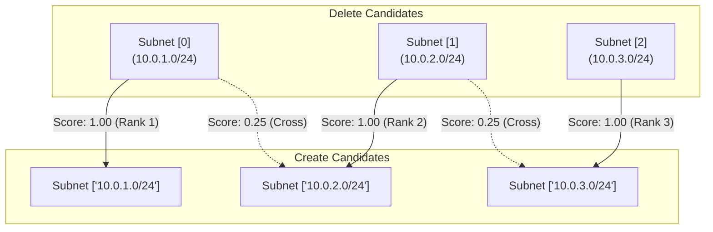

# Matching Algorithm & Heuristics

The heart of `tf-move-gen` is its weighted bipartite matching engine. This document details how similarity scores are calculated and how resources are paired.

---

## The Matching Challenge

When Terraform destroys a resource at address $A$ and creates a new resource at address $B$, the two objects share many of the same configuration attributes, but also have critical differences:

1. **Unknown Attributes:** In the `create` action, cloud-generated values (like `id`, `arn`, `unique_id`, `created_date`) are marked as `unknown` in `after_unknown` because they cannot exist until applied.
2. **Order Variations:** Sets (like security group IDs or tags) may be ordered differently in state than in configuration.
3. **Identifier Dominance:** A match on a unique identifier (such as `bucket = "my-prod-bucket"`) is vastly more informative than a match on a generic flag (such as `force_destroy = false`).

---

## 1. Candidate Filtering & Grouping

Candidates are partitioned into mutually exclusive groups by:
- **Resource Type:** (e.g., `aws_s3_bucket`, `aws_security_group`, `aws_db_instance`)
- **Normalized Provider:** (e.g., `aws`, `azurerm`, `google`)

An `aws_s3_bucket` will **never** be matched against an `aws_iam_role`, ensuring absolute isolation between resource types.

---

## 2. Computed Field Stripping

Before comparing attributes, `tf-move-gen` cleanses the attribute set:

- **`after_unknown` suppression:** If an attribute path is present in `after_unknown` with a `true` value or nested map, it is completely ignored.
- **Transient attribute suppression:** The following provider-managed attributes are ignored if they are missing or `null` in the target configuration:
  - `id`, `arn`, `etag`, `unique_id`
  - `create_date`, `created_date`, `time_created`
  - `generation`, `self_link`, `version_id`, `deposed_key`

This ensures that an `aws_db_instance` with a populated `id` and `arn` in `before` can still match an identical `aws_db_instance` in `after` with **100% confidence**.

---

## 3. Weighted Similarity Calculation

Each non-ignored attribute path $k$ is assigned a weight $w_k$:

### High-Signal Identifying Attributes ($w_k = 2.0$)
- `name`, `bucket`, `identifier`, `cidr_block`, `function_name`, `role`, `tags.Name`
- Any attribute path ending in `.name`, `.identifier`, `.cidr_block`, `.bucket`, `.function_name`, or `.role`.

### Generic Configuration Attributes ($w_k = 1.0$)
- All other non-ignored attributes (e.g., `acl`, `instance_class`, `engine`, `allocated_storage`, `map_public_ip_on_launch`).

### Value Similarity $s_k$ (0.0 to 1.0)
- **Primitives (string, number, boolean):** $1.0$ if values are equal, otherwise $0.0$.
- **Slices / Sets:** Calculated using the **Jaccard Similarity Index**:
  $$J(S_1, S_2) = \frac{|S_1 \cap S_2|}{|S_1 \cup S_2|}$$
- **Missing vs Present:** If an attribute is present with a value in one resource but `null` / missing in the other, $s_k = 0.0$.
- **Both Null:** If an attribute is `null` or missing in both, it is omitted from the comparison to prevent artificial score inflation from unused provider defaults.

### Total Confidence Score
The final confidence score between delete candidate $d$ and create candidate $c$ is:

$$\text{Confidence}(d, c) = \frac{\sum_{k} w_k \cdot s_k}{\sum_{k} w_k}$$

---

## 4. Greedy Bipartite Matching

Once similarity scores are computed for all delete-create pairs within a resource group:



1. All candidate pairs with $\text{Confidence}(d, c) \ge \text{min-confidence}$ (default $0.70$) are retained.
2. Candidate pairs are sorted descending by score:
   $$\text{Pair}_1 \ge \text{Pair}_2 \ge \dots \ge \text{Pair}_N$$
   *(Ties are broken deterministically by resource address).*
3. Iterate through sorted pairs:
   - If neither $d$ nor $c$ has been matched yet, finalize the match $d \rightarrow c$.
   - Mark both $d$ and $c$ as claimed.
4. Any candidate deletion that remains unmatched is placed in `UnmatchedDeletes`.

---

## 5. Confidence Explanations (`--explain`)

When `--explain` is enabled, `tf-move-gen` outputs detailed confidence summaries directly above each generated block:

```hcl
# Confidence: 98.2% (matched on: cidr_block, enable_dns64, map_public_ip_on_launch, tags, vpc_id)
moved {
  from = aws_subnet.public[0]
  to   = aws_subnet.public["10.0.1.0/24"]
}
```

Any deletions with similarity below `--min-confidence` are emitted to `stderr` as warnings:

```text
[WARNING] Unmatched delete: aws_security_group.obsolete_bastion
```
